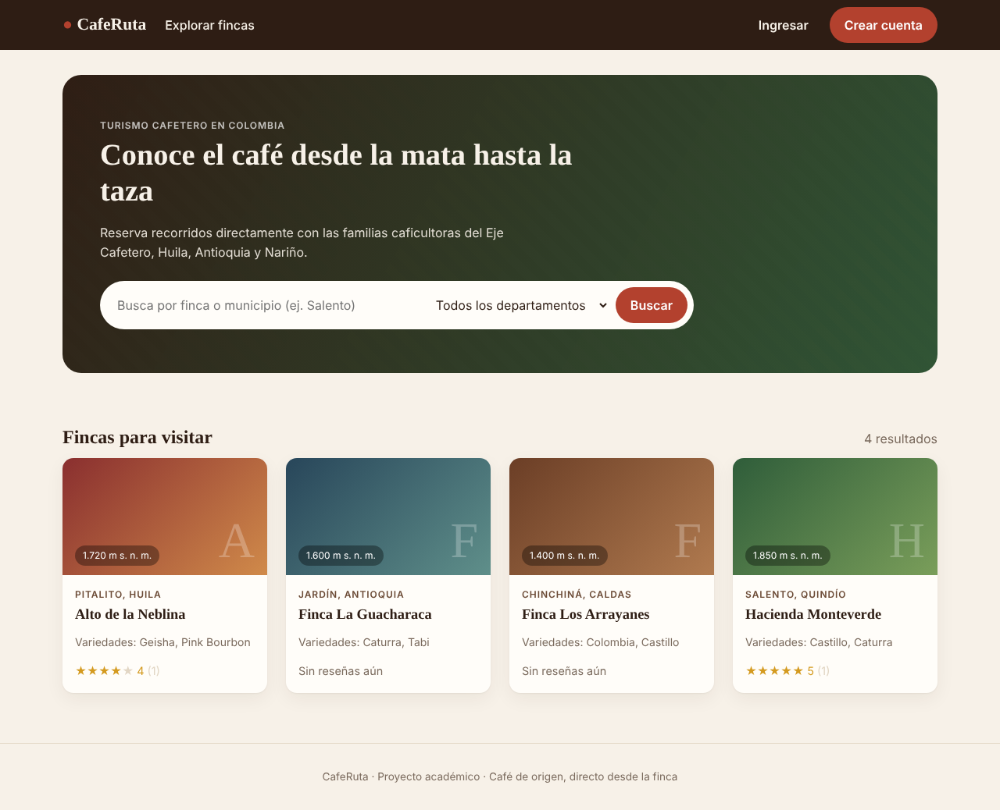

# CafeRuta ☕ — Tours en fincas cafeteras de Colombia

Plataforma web para reservar recorridos en fincas cafeteras. Los **visitantes** exploran fincas y reservan tours, los **caficultores** publican su finca y gestionan sus reservas, y el **administrador** aprueba las fincas nuevas.

**Presentado por:** Juan Diego Bonilla Orozco

**Stack:** Node.js + Express · PostgreSQL · JWT · React (Vite) · Docker



Más capturas en la carpeta [`capturas/`](capturas/): detalle de finca, mis reservas, panel del caficultor, reservas recibidas y panel de administración.

## Roles y permisos

| Acción | Visitante | Caficultor | Admin |
| --- | :---: | :---: | :---: |
| Ver catálogo y detalle de fincas | ✓ | ✓ | ✓ |
| Reservar un tour / cancelar su reserva | ✓ | | ✓ |
| Reseñar una finca (con reserva confirmada) | ✓ | | |
| Registrar y editar **su** finca, crear **sus** tours | | ✓ | ✓ |
| Confirmar o rechazar reservas de **sus** tours | | ✓ | ✓ |
| Aprobar fincas y ver estadísticas | | | ✓ |

Hay dos niveles de autorización: **por rol** (`authorize('caficultor')`) y **por propiedad** (`assertOwnerOrAdmin`: un caficultor no puede tocar la finca de otro).

## Estructura

```
caferuta/
├── backend/
│   ├── src/
│   │   ├── auth/            jwt.js · middleware.js (authenticate, authorize) · ownership.js
│   │   ├── routes/          auth · fincas · tours · reservas · admin
│   │   ├── repositories/    consultas SQL a PostgreSQL
│   │   ├── services/        reservationRules.js (cupos, precios, estados)
│   │   ├── utils/           validación y errores HTTP
│   │   ├── app.js           Express + CORS + helmet + manejador de errores
│   │   └── config.js        lee variables de entorno
│   ├── tests/
│   │   ├── unit/            middlewares y reglas de negocio
│   │   └── integration/     API completa con Supertest + PostgreSQL en memoria (pg-mem)
│   ├── db/                  schema.sql · seed.sql (datos de demo)
│   └── Dockerfile
├── frontend/
│   ├── src/
│   │   ├── api/client.js    fetch + token + manejo de errores
│   │   ├── hooks/useApi.js  estados loading / error / data
│   │   ├── auth/            AuthContext · ProtectedRoute
│   │   ├── components/      Navbar, FincaCard, formularios, estados...
│   │   └── pages/           Explorar, FincaDetalle, Login, Registro, MisReservas, PanelCaficultor, PanelAdmin
│   ├── Dockerfile           build con Vite + Nginx
│   └── nginx.conf
├── docker-compose.yml       db + backend + frontend
└── .env.example
```

## Cómo ejecutarlo

### Opción A: todo con Docker (recomendado)

```bash
cp .env.example .env            # cambia DB_PASSWORD y JWT_SECRET
docker compose up --build
```

- Frontend: http://localhost:5173
- API: http://localhost:3000/health

Para reiniciar la base de datos con los datos de demo: `docker compose down -v` y vuelve a levantar.

### Opción B: sin Docker

Necesitas PostgreSQL 14+ con una base `caferuta` donde ejecutes `backend/db/schema.sql` y `backend/db/seed.sql`.

```bash
cd backend
cp .env.example .env            # ajusta DATABASE_URL y JWT_SECRET
npm install
npm run dev                     # http://localhost:3000

cd ../frontend
cp .env.example .env
npm install
npm run dev                     # http://localhost:5173
```

## Cuentas de prueba

Contraseña de todas: `Cafe2026!`

| Correo | Rol | Qué probar |
| --- | --- | --- |
| laura@caferuta.co | visitante | Reservar, cancelar, ver reseñas |
| andres@caferuta.co | visitante | Tiene una reserva pendiente |
| jorge@caferuta.co | caficultor | Hacienda Monteverde y Los Arrayanes |
| marta@caferuta.co | caficultor | Tiene una finca pendiente de aprobación |
| admin@caferuta.co | admin | Aprobar "Finca Agua Clara", ver estadísticas |

## Pruebas

```bash
cd backend
npm test                  # 21 pruebas
npm run test:unit
npm run test:integration
```

## Endpoints principales

| Método | Ruta | Acceso |
| --- | --- | --- |
| POST | /api/auth/register | público (solo visitante o caficultor) |
| POST | /api/auth/login | público |
| GET | /api/auth/me | autenticado |
| GET | /api/fincas?departamento=&q= | público |
| GET | /api/fincas/:id | público (si no está aprobada: dueño o admin) |
| GET | /api/fincas/mine | caficultor |
| POST | /api/fincas | caficultor |
| PUT | /api/fincas/:id | caficultor dueño o admin |
| POST | /api/fincas/:id/tours | caficultor dueño o admin |
| POST | /api/fincas/:id/resenas | visitante con reserva confirmada |
| PUT / DELETE | /api/tours/:id | caficultor dueño o admin |
| POST | /api/reservas | visitante |
| GET | /api/reservas/mine | visitante |
| GET | /api/reservas/recibidas | caficultor |
| PATCH | /api/reservas/:id/status | según rol y propiedad |
| GET | /api/admin/stats | admin |
| GET | /api/admin/fincas?status= | admin |
| PATCH | /api/admin/fincas/:id/status | admin |
